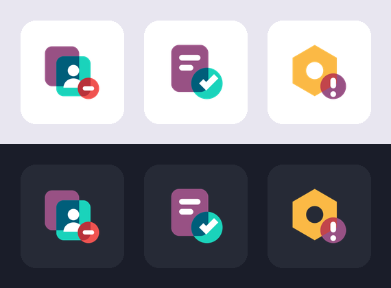

# Odoo Skills

[](https://skills.sh/EmanuelAlv/odoo-skills)

Agent skills para desarrollo en Odoo, compatibles con Claude Code, Cursor, Codex y cualquier agente que soporte el formato `SKILL.md`.

*Agent skills for Odoo development (Claude Code, Cursor, Codex and any agent supporting `SKILL.md`).*

## Instalación

```bash
npx skills add EmanuelAlv/odoo-skills
```

Solo una skill:

```bash
npx skills add EmanuelAlv/odoo-skills --skill odoo-module-icons
```

O directo desde npm (Claude Code):

```bash
npx odoo-module-icons            # global: ~/.claude/skills/
npx odoo-module-icons --project  # proyecto: ./.claude/skills/
```

## Skills

### `odoo-module-icons`

Diseña el `icon.png` de un módulo de Odoo para que se vea nativo en el menú de aplicaciones de Odoo 19, en tema claro y oscuro: formas planas, paleta oficial, cruces de color y fondo transparente. Entrega `icon.png` (256×256 RGBA), una previsualización y el XML del `menuitem` con `web_icon`.



Uso: pide a tu agente algo como *"crea el icono para mi módulo `stock_alert`, que avisa cuando un producto baja del mínimo"*.

Requisitos para exportar el PNG: Python con `cairosvg` y `pillow`.

## Licencia

MIT
